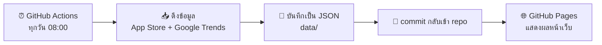

# 🆕 Trend Dashboard

> ติดตามแอปใหม่มาแรงในไทย อัปเดตทุกวันอัตโนมัติ

[](https://github.com/B1ackmonday/trend-dashboard/actions/workflows/update-trends.yml)


🔗 **เปิดใช้งาน:** [แอปใหม่มาแรง](https://b1ackmonday.github.io/trend-dashboard/new.html)

---

## ✨ ฟีเจอร์

- 🆕 **แอปใหม่มาแรง** ดูแอปที่ออกภายใน 60 วัน กรองตามหมวดและอายุได้
- 🏆 **App Charts** อันดับ Top Free ของ App Store ไทย แยกตามหมวด
- 📈 **Google Trends** ความนิยมของคำค้นในไทย 3 เดือนย้อนหลัง

## 🧭 วิธีการจัดอันดับ "แอปใหม่"

ระบบไม่ได้ดูแค่ว่าแอปใหม่หรือไม่ แต่ใช้หลายสัญญาณประกอบกัน

| สัญญาณ | ความหมาย |
| --- | --- |
| **อยู่ในรายการแอปใหม่** | Apple เพิ่งเปิดตัวแอปนั้นในหมวดดังกล่าว |
| **ติดชาร์ตขายดี** | แอปนั้นเข้าอันดับ Top Free แล้ว |
| **รีวิวเพิ่มจากวันก่อน** | ตัวแทนของการเติบโต เพราะ Apple ไม่เปิดเผยยอดดาวน์โหลด |

## ⚙️ การทำงาน



ข้อมูลทุกวันถูกเก็บใน git history จึงย้อนดูการเปลี่ยนแปลงได้

## 📁 โครงสร้างโปรเจกต์

```
trend-dashboard/
├── .github/workflows/   ตารางเวลาและงานอัตโนมัติ
├── assets/              CSS และ JavaScript ของหน้าเว็บ
├── config/              ไฟล์ตั้งค่า หมวด และประเทศ
├── data/                ข้อมูลที่สคริปต์สร้างทุกวัน
├── scripts/             สคริปต์ดึงข้อมูล
├── index.html           Google Trends
├── apps.html            App Charts
└── new.html             แอปใหม่
```

## 🛠️ รันบนเครื่อง

```bash
git clone https://github.com/B1ackmonday/trend-dashboard.git
cd trend-dashboard
python -m venv .venv
pip install -r requirements.txt
python scripts/fetch_apps.py
python scripts/fetch_new_apps.py
python -m http.server 8000
```

แล้วเปิด `http://localhost:8000/new.html`

## 🎛️ ปรับแต่ง

แก้ไฟล์ `config/app_charts.json` เพื่อ

- เพิ่มหรือลบหมวดสินค้า ใส่รหัสหมวดจาก App Store
- เปลี่ยนเกณฑ์อายุแอปใหม่ที่ `new_app_max_days`
- เปลี่ยนประเทศที่ `country` เช่น `th`, `us`, `jp`

## 📡 แหล่งข้อมูล

- **App Store RSS** feed สาธารณะของ Apple สำหรับชาร์ตและแอปใหม่
- **iTunes Lookup API** สำหรับวันที่ปล่อยแอปและจำนวนรีวิว
- **Google Trends** ผ่านไลบรารี `pytrends`

> ⚠️ **ข้อจำกัด:** feed ของ Apple ไม่ได้รับรองอย่างเป็นทางการ และ Google Trends ให้ค่าความนิยมแบบสัมพัทธ์ (0–100) ไม่ใช่จำนวนจริง ข้อมูลนี้ใช้เป็นแนวทางประกอบการตัดสินใจ ไม่ใช่ตัวเลขที่ยืนยันได้

---

<sub>สร้างด้วย Python, GitHub Actions และ GitHub Pages</sub>