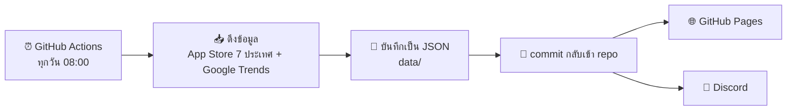

# 🆕 Trend Dashboard

> ค้นหาไอเดียสร้างแอป จากแอปใหม่มาแรง แอปที่กำลังจะออก และแอปที่ดังในต่างประเทศ อัปเดตทุกวันอัตโนมัติ

[](https://github.com/B1ackmonday/trend-dashboard/actions/workflows/update-trends.yml)


🔗 **เปิดใช้งาน:** [New & Trending Apps](https://b1ackmonday.github.io/trend-dashboard/new.html)

---

## ✨ ฟีเจอร์

หน้าเว็บเป็นภาษาอังกฤษ ใช้งานได้ทั้งคอมและมือถือ

| หน้า | ใช้ทำอะไร |
| --- | --- |
| 🆕 **New Apps** (`new.html`) | แอปที่ออกภายใน 60 วัน และแอปพรีออเดอร์ที่ยังไม่ออก เรียงตามคะแนนมาแรง ดูคำอธิบายและภาพหน้าจอได้ มีหมวดที่กำลังมาแรง และ export CSV |
| 🏆 **Charts** (`apps.html`) | Top Free / Top Paid / Top Grossing ของไทย 12 หมวด พร้อมการขึ้นลงจากวันก่อนและกราฟอันดับย้อนหลัง 30 วัน |
| 🌏 **Global** (`compare.html`) | เทียบชาร์ต 7 ประเทศ หาแอปที่ดังในต่างประเทศแต่ยังไม่ติดชาร์ตหรือยังไม่มีขายในไทย |
| 📈 **Google Trends** (`index.html`) | ความนิยมของคำค้นในไทย 3 เดือนย้อนหลัง แยกกราฟตามกลุ่มคำ |
| 💬 **Discord** | ส่งสรุปรายวันเข้าช่องใน Discord (ดูวิธีตั้งค่าด้านล่าง) |

ตัวกรองทุกหน้าถูกเก็บไว้ใน URL จึง bookmark หรือส่งลิงก์มุมมองที่กรองแล้วให้คนอื่นได้

## 🧭 วิธีการจัดอันดับ "แอปใหม่"

| สัญญาณ | ความหมาย |
| --- | --- |
| **ติดชาร์ต** | สัญญาณที่ชัดที่สุด Top Free และ Top Grossing ได้น้ำหนักเต็ม Top Paid ได้ 60% ชาร์ตหมวดได้ 60% ของชาร์ตรวม |
| **รีวิวเพิ่มต่อวัน** | ตัวแทนของการเติบโต เพราะ Apple ไม่เปิดเผยยอดดาวน์โหลด |
| **ความใหม่** | แอปที่ทำผลงานได้ตั้งแต่อายุน้อยได้คะแนนเพิ่ม |

รายชื่อแอปมาจาก 3 ทาง คือชาร์ตทุกหมวด, feed แอปใหม่ (ฟรีและเสียเงิน) ของ Apple และแอปที่ติดตามไว้จากรอบก่อน

- **แอปพรีออเดอร์** ถูกเก็บไว้เสมอและติดตามต่อจนถึงวันปล่อย ดูได้ที่ตัวกรอง Status → Upcoming
- แอปที่ออกแล้วแต่ไม่มีรีวิวและไม่ติดชาร์ต จะถูกติดตามแค่ 7 วันแรก
- ประวัติรีวิวรายวันเก็บใน `data/new_apps.json` ประวัติอันดับเก็บใน `data/rank_history/`

## 💬 ตั้งค่าแจ้งเตือน Discord

ทำครั้งเดียว ใช้เวลาประมาณ 3 นาที

**1. สร้าง webhook ใน Discord**

1. เปิด Discord ไปที่ server ของคุณ คลิกชื่อ server มุมซ้ายบน → **Server Settings**
2. เลือก **Integrations** → **Webhooks** → **New Webhook**
3. ตั้งชื่อ (เช่น `Trend Dashboard`) และเลือกช่องที่จะให้โพสต์
4. กด **Copy Webhook URL**

> 🔒 URL นี้คือรหัสลับ ใครได้ไปก็โพสต์เข้าช่องคุณได้ ห้ามใส่ลงในไฟล์ใน repo หรือแปะในที่สาธารณะ

**2. เก็บ URL ไว้ใน GitHub Secret**

1. เปิด repo บน GitHub → **Settings** → **Secrets and variables** → **Actions**
2. กด **New repository secret**
3. Name: `DISCORD_WEBHOOK_URL` · Secret: วาง URL ที่ copy มา → **Add secret**

**3. ทดสอบ**

ไปที่แท็บ **Actions** → **Update trends** → **Run workflow** รอสักครู่ ข้อความจะเข้าช่อง Discord
หลังจากนั้นจะส่งอัตโนมัติทุกวันเวลา 08:00

ดูตัวอย่างข้อความบนเครื่องโดยไม่ส่งจริงได้ด้วย `python scripts/notify_discord.py --dry-run`

## ⚙️ การทำงาน



## 📁 โครงสร้างโปรเจกต์

```
trend-dashboard/
├── .github/workflows/   งานอัตโนมัติรายวัน
├── assets/              CSS และ JavaScript ของหน้าเว็บ
├── config/              ตั้งค่าชาร์ต หมวด ประเทศ และคำค้น
├── data/                ข้อมูลที่สคริปต์สร้างทุกวัน
│   └── rank_history/    ประวัติอันดับ 30 วัน แยกไฟล์ตามชาร์ตและหมวด
├── scripts/
│   ├── fetch_apps.py        ชาร์ตไทย 3 ชาร์ต × 12 หมวด
│   ├── fetch_new_apps.py    แอปใหม่ แอปพรีออเดอร์ และคะแนนมาแรง
│   ├── fetch_global.py      ชาร์ตหลายประเทศ
│   ├── fetch_trends.py      Google Trends
│   └── notify_discord.py    ส่งสรุปเข้า Discord
├── new.html             New Apps
├── apps.html            Charts
├── compare.html         Global
└── index.html           Google Trends
```

## 🛠️ รันบนเครื่อง

```bash
git clone https://github.com/B1ackmonday/trend-dashboard.git
cd trend-dashboard
python -m venv .venv
.venv\Scripts\activate        # macOS/Linux: source .venv/bin/activate
pip install -r requirements.txt
python scripts/fetch_apps.py        # ต้องรันก่อนสคริปต์อื่น
python scripts/fetch_new_apps.py
python scripts/fetch_global.py
python scripts/fetch_trends.py
python -m http.server 8000
```

แล้วเปิด `http://localhost:8000/new.html`

## 🎛️ ปรับแต่ง

แก้ไฟล์ `config/app_charts.json`

| ค่า | ความหมาย |
| --- | --- |
| `country` | ประเทศหลัก เช่น `th` |
| `site_url` | URL ของหน้าเว็บ ใช้ทำลิงก์ในข้อความ Discord |
| `charts` | ชาร์ตที่ดึง (Top Free / Paid / Grossing) |
| `genres` | หมวดที่ดึง ใส่รหัสหมวดของ App Store |
| `new_app_max_days` | อายุแอปสูงสุดที่ยังนับเป็นแอปใหม่ |
| `quiet_track_days` | จำนวนวันที่ติดตามแอปที่ยังไม่มีสัญญาณ |
| `history_days` | จำนวนวันที่เก็บประวัติอันดับ |
| `compare.countries` | ประเทศที่ใช้เทียบในหน้า Global |

แก้ไฟล์ `config/keywords.json` เพื่อเปลี่ยนคำค้นของ Google Trends (กลุ่มละไม่เกิน 5 คำ ค่าเทียบกันได้เฉพาะภายในกลุ่มเดียวกัน)

## 📡 แหล่งข้อมูล

- **App Store RSS** feed สาธารณะของ Apple สำหรับชาร์ตและแอปใหม่
- **iTunes Lookup API** สำหรับวันที่ปล่อย รีวิว คำอธิบาย ภาพหน้าจอ และเช็กว่าแอปมีขายในประเทศไหน
- **Google Trends** ผ่านไลบรารี `pytrends`

> ⚠️ **ข้อจำกัด:** feed ของ Apple ไม่ได้รับรองอย่างเป็นทางการ และ Google Trends ให้ค่าความนิยมแบบสัมพัทธ์ (0–100) ไม่ใช่จำนวนจริง ข้อมูลนี้ใช้เป็นแนวทางประกอบการตัดสินใจ ไม่ใช่ตัวเลขที่ยืนยันได้

---

<sub>สร้างด้วย Python, GitHub Actions และ GitHub Pages</sub>
